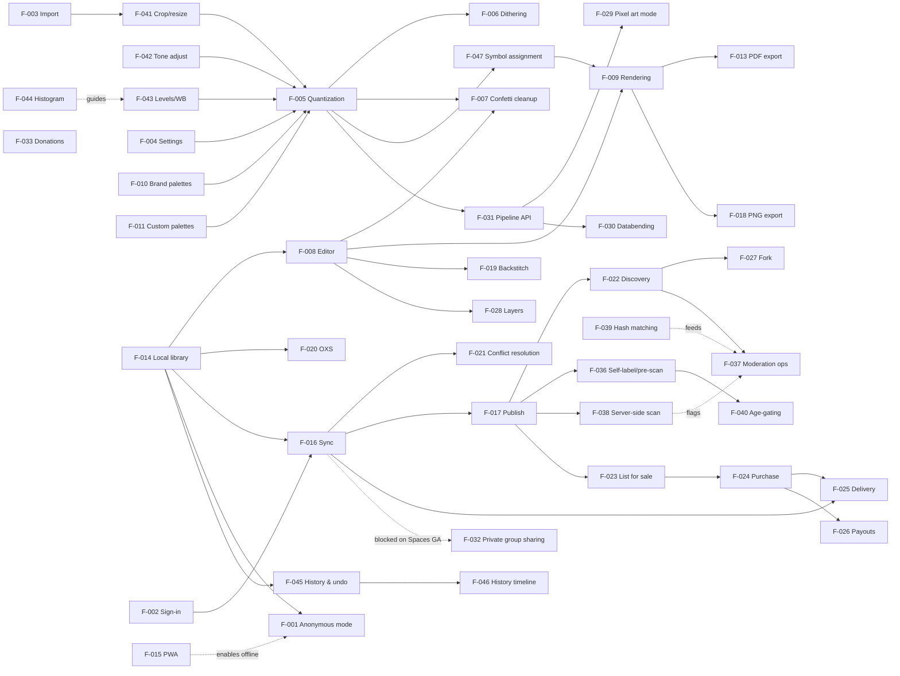

# Stitch'n'Glitch Online — Product Requirements Document (PRD)

> Version: v1.15 | Author: Project team | Date: 2026-11-09
> Status: Complete draft — all open questions (Q1–Q9) resolved (v1.15: spike S5 results — F-047 confusability-matrix generator validated end to end in Gleam (canvas rasterization is the only FFI); 13-glyph stand-in SVG set rasterized at 6/8/12/16 px cells, ink-bleed variants (blur + erosion) computed in the 3× print domain, 5 curated overrides merged, deterministic max-min assignment consumed the matrix at every size; measured candidate minimum supported chart-cell **16 px at the 100%-zoom binding density** with 5.2× margin over the cross-renderer noise floor — 12 px marginal (1.4×), 8 px and below fail, quantifying the minimum-feature-size rule at ≈14% of cell height; pixel distance confirmed blind to mirror/rotation/subset confusables, so curated overrides are load-bearing; full WebGL + two-PDF-engine matrix validation remains M5 work per AC-F047-05); v1.14: PDF export vector decision — fully vector client-side PDF via **jsPDF** from a single chart-layout module shared with the WebGL renderer; chart symbols are embedded-TTF text runs via a build-time **symbol font** generated from the curated **SVG symbol library** (single glyph source, also feeding the WebGL glyph atlas and UI sprite); svg2pdf.js reserved for complex vector graphics; new AC-F013-05 (vector at any print scale) and AC-F047-05 (cross-renderer + print validation of confusability matrices at minimum cell size / worst-case px-per-cell); v1.13: spike S2 results — PNG IDAT corruption dropped from v1.0 databend modes (CRC32-repair hypothesis falsified: single-byte IDAT flips desync the deflate stream); shipped modes are JPEG payload swap + BMP/TGA WordPad; decode probe standardized on `createImageBitmap`; v1.12: spike S1 results — NFR-P1 confirmed with 4.7× headroom; specialized CIEDE2000 hot path adopted with thi.ng as property-test oracle; >64-color palettes need a shortlist pre-filter; v1.11: chart legibility — PDF layout options (single-page / paged A4/US Letter), three chart styles, F-047 max-min symbol assignment; v1.10: Q9 — founder-solo moderation at launch, user report flow, application path to moderator; v1.9: undo & non-destructive history model — F-045/F-046 + §7.7; v1.8: F-030 promoted from Could to Must (MVP) per user decision; v1.7: F-030 redefined as real byte-level databending. v1.6: F-041–F-044; v1.5: Q8; v1.4: Q7; v1.3: Q3–Q6; v1.2: Q2; v1.1: Q1)

## 1. Overview

### 1.1 Background & Motivation

Stitch'n'Glitch Online is a local-first web application whose flagship workflow is **image-to-cross-stitch-pattern conversion**, built on top of a **generic, pluggable image-processing architecture** that also supports pixel art and glitch art creation. Today, stitchers choose between cloud-locked tools (Stitch Fiddle, Stitchmate), browser tools that store work only in `localStorage` where it can be silently lost (FlossCross), or aging desktop software (PCStitch, WinStitch). None give users true ownership of their data, offline capability, and an open network for sharing and selling.

Stitch'n'Glitch applies the local-first principles described by Ink & Switch: the app is fully functional without an internet connection, and user data lives primarily on the user's device. Synchronization and identity are built on the AT Protocol (ATProto): each user's patterns, palettes, and listings are stored as records in their own Personal Data Server (PDS) repository, so data is portable, user-owned, and independent of this application's operator. Target users are both hobbyist crafters and professional pattern designers; professionals are additionally served by a marketplace for selling digital patterns.

### 1.2 Objectives

- **Business objective:** Become the reference open, local-first tool for cross-stitch pattern creation; monetize via marketplace commission and voluntary donations only (Q3 decision) — no subscriptions, paywalled features, or lock-in.
- **User objective:** Turn any image into a high-quality, stitchable pattern with full creative control (editing, palettes, cleanup), keep working offline, own their data, and optionally publish and sell their work on an open network.
- **Success metrics:**
- North Star: weekly patterns completed (exported, published, or purchased) per active user
- Photo → pattern conversion completion rate ≥ 60%
- ≥ 40% of returning users enable ATProto sync within first month
- Offline session share ≥ 25% of all sessions (validates local-first value)
- Marketplace: ≥ 100 listed patterns and ≥ 500 purchases in the first quarter after the Spaces-gated marketplace launch (v1.2+, Q4 decision)
- P95 image conversion time ≤ 5 s for a 12 MP source image on mid-range hardware

### 1.3 Scope

- **In scope (v1.0–v1.1):** Local-first pattern creation (import → convert → edit → export); thread palette management and custom palette creation; offline PWA; ATProto sign-in, sync, and publishing; pattern discovery; donations; the seeded databending (real glitch) engine (F-030); full localization (EN/DE/FR/ES/NL) and WCAG 2.2 AA accessibility; content moderation (self-labeling with on-device pre-scan, labeler + human review, classification backstop, hash-matching, age gating — see §4.4). **Gated on ATProto Spaces GA (v1.2+):** marketplace (listing, purchase, delivery, payouts) and private group sharing (Q4 decision).
- **Out of scope (this time):** Native iOS/Android apps; real-time multi-user collaboration; AI text-to-pattern generation; physical goods or fulfillment; a proprietary non-ATProto account system (see §5.1 Won't Have).

## 2. User Personas

| Persona | One-line description |
| --- | --- |
| **Hannah — Hobbyist Stitcher** | Casual cross-stitcher who wants to turn family photos into patterns and share results with friends. |
| **Priya — Professional Designer** | Pattern designer who sells digital charts and needs precise palettes, backstitch, and print-ready exports. |
| **Gus — Pixel/Glitch Artist** | Digital artist who wants dithering, glitch effects, and pixel-art tooling on an open protocol. |
| **Bella — Pattern Buyer** | Avid stitcher who discovers, buys, and stitches other people's patterns across multiple devices. |

**Hannah — Hobbyist Stitcher**

- Role: Hobbyist / casual user
- Core Goal: Convert photos into stitchable patterns with minimal fuss
- Primary Pain Point: Free tools produce confetti-ridden charts or hold her work hostage in cloud accounts / fragile browser storage

**Priya — Professional Designer**

- Role: Independent pattern designer / seller
- Core Goal: Produce sale-quality patterns and earn income from them
- Primary Pain Point: Creation and selling are split across tools (editor + Etsy/Gumroad); platforms own the customer relationship and her data

**Gus — Pixel/Glitch Artist**

- Role: Digital artist
- Core Goal: Experiment with dithering, palettes, and glitch aesthetics; publish to an open network
- Primary Pain Point: Existing pixel/glitch tools are closed silos with no data portability

**Bella — Pattern Buyer**

- Role: Consumer / stitcher
- Core Goal: Find great patterns, buy them once, and use them on any device
- Primary Pain Point: Purchased patterns are scattered across shops, emails, and apps with no unified library

## 3. User Stories

**Hannah — Hobbyist Stitcher**

- **US-001:** As Hannah, I want to import a photo and convert it into a pattern with my chosen stitch count and color count, so that I get a stitchable chart without manual work. → F-003, F-004, F-005, F-006, F-008, F-009
- **US-002:** As Hannah, I want to clean up scattered single stitches ("confetti") quickly, so that my pattern is pleasant to stitch. → F-007
- **US-003:** As Hannah, I want to use the app fully without creating an account or being online, so that my work is never blocked by connectivity or sign-ups. → F-001, F-014, F-015
- **US-004:** As Hannah, I want to share a finished pattern with friends as an image or a public link, so that they can admire or stitch it too. → F-017, F-018
- **US-015:** As Hannah, I want to optionally donate to support the app's development, so that it stays free, independent, and free of subscriptions and ads. → F-033
- **US-016:** As Hannah, I want to use the app in German, so that I can work comfortably in my native language. → F-034
- **US-021:** As Hannah, I want to crop my photo and fix its brightness, contrast, and color cast before converting, so that the limited thread palette is spent on the subject rather than wasted on a bad exposure. → F-041, F-042, F-043, F-044
- **US-022:** As Hannah, I want to undo any operation — even a crop or a glitch that feels irreversible — so that I can experiment freely without fear of ruining my work. → F-045, F-046
- **US-023:** As Hannah, I want chart symbols that are easy to tell apart and print layouts that suit how I stitch (one big sheet or paged A4/US Letter, color or black-and-white), so that I don't confuse colors or lose my place. → F-047, F-009, F-013

**Priya — Professional Designer**

- **US-005:** As Priya, I want to manage brand thread palettes and build custom palettes (including importing palettes and OXS files from desktop tools), so that my charts match the threads I actually use. → F-010, F-011, F-012, F-020
- **US-006:** As Priya, I want to add backstitch, fractional stitches, and layered detail work, so that my designs meet professional quality standards. → F-008, F-019, F-028
- **US-007:** As Priya, I want to export a print-ready PDF with symbol chart, color key, and skein usage, so that my customers get a professional document. → F-013, F-009
- **US-008:** As Priya, I want to list patterns for sale, get paid, and track sales and payouts, so that selling requires no extra platform. → F-023, F-024, F-025, F-026
- **US-019:** As Priya, I want my artistic-nudity patterns accepted with proper labeling instead of being removed, so that legitimate work isn't collateral damage of moderation. → F-036, F-038

**Gus — Pixel/Glitch Artist**

- **US-009:** As Gus, I want dithering algorithms and real databending (byte-level corruption, not cosmetic filters) applied during import, so that I can create distinctive retro/corrupted aesthetics. → F-006, F-030
- **US-010:** As Gus, I want a generic pixel-art mode and a pluggable filter pipeline, so that the tool serves image-processing use cases beyond cross stitch. → F-029, F-031
- **US-011:** As Gus, I want to publish my work to an open network while retaining ownership of my data, so that I'm not locked into any single platform. → F-002, F-016, F-017

**Bella — Pattern Buyer**

- **US-012:** As Bella, I want to browse and search published patterns and fork free ones into my library, so that I always have something new to stitch. → F-022, F-027
- **US-013:** As Bella, I want to buy a pattern and access it immediately and permanently in my library, so that my purchase can never be revoked by a shop closing. → F-024, F-025
- **US-014:** As Bella, I want my library to sync across all my devices — and keep working offline — without manual file management, so that I can pick up any device and continue. → F-002, F-015, F-016, F-021
- **US-017:** As Bella, I want to operate the entire app by keyboard and with a screen reader, so that low vision never locks me out of my hobby. → F-035
- **US-018:** As Bella, I want adult and graphic content hidden unless I explicitly opt in, so that I control what appears in my feed. → F-036, F-040
- **US-020:** As Bella, I want to report rule-breaking content and see a resolution with an appeal path, so that the community stays safe. → F-037, F-039

## 4. Functional Requirements

### 4.1 Feature List

| Feature ID | Feature Name | User Stories | Description | Input / Output / Interaction Notes |
| --- | --- | --- | --- | --- |
| F-001 | Anonymous local mode | US-003 | Full creation flow without any account; all data stays on the device | In: none; Out: patterns saved to local library; account optional at all times |
| F-002 | ATProto OAuth sign-in | US-011, US-014 | Sign in with an existing ATProto identity (handle/DID) via the ATProto OAuth profile | In: handle or PDS URL; Out: authenticated session (DPoP-bound tokens); used for sync, publishing, selling, buying; new-signup guidance recommends only Spaces-enabled PDS providers (Q2 decision) |
| F-003 | Image import | US-001 | Import raster images via file picker, drag & drop, or clipboard paste | In: JPEG/PNG/WebP/GIF ≤ 20 MB; Out: decoded bitmap in the processing pipeline; rejects corrupt/unsupported files with a clear error |
| F-004 | Conversion settings | US-001 | Configure target stitch count (W×H), max colors, and fabric count with live size preview | Bounds: 10–1000 stitches per side, 2–256 colors, fabric 11–25 ct; Out: conversion parameters |
| F-005 | Thread-matched quantization | US-001 | Reduce image colors to the selected thread palette using perceptual color distance (CIEDE2000) | In: bitmap + palette (F-010/F-011); Out: indexed stitch grid; runs in a Web Worker |
| F-006 | Dithering options | US-001, US-009 | Optional dithering during conversion: none / Floyd–Steinberg / ordered Bayer, with strength control | In: conversion settings; Out: dithered indexed grid; live preview update |
| F-007 | Confetti cleanup | US-002 | Detect isolated stitches (confetti), auto-fix with adjustable threshold, plus a manual cleanup brush | In: indexed grid; Out: cleaned grid with undo support; shows count of affected stitches |
| F-008 | Chart editor core | US-001, US-006 | Grid editor: pencil, eraser, flood fill, line, rectangle, ellipse, selection + move, color picker, unlimited undo/redo (via the F-045 history model) | In: pointer/keyboard input; Out: document edits; autosaves to library |
| F-009 | Symbol chart rendering | US-001, US-007, US-023 | WebGL-accelerated chart renderer: symbol-per-color mapping (assigned by F-047); chart styles — **symbols on colored background, colored symbols only, black-and-white symbols only**; smooth zoom (10–4000 %) and pan | In: document model + style choice; Out: rendered canvas; symbol sets include colorblind-safe variants; chosen style carries into PDF export (F-013); glyphs are sourced from the curated **SVG symbol library** — the single glyph source for the WebGL glyph atlas, the UI sprite, and the build-time PDF symbol font (v1.14) |
| F-010 | Brand thread palettes | US-005 | Built-in DMC and Anchor palettes with official codes and names; per-pattern thread usage statistics; patterns may mix brands and raw digital colors (Q5 decision) | In: palette selection; Out: thread legend + usage (stitch count and estimated skeins per color) |
| F-011 | Custom palette creation | US-005 | Create custom palettes manually or extract a palette from an image; entries can be brand threads (DMC/Anchor) or raw digital colors (name, code, RGB/hex), freely mixed in one palette (Q5 decision) | In: image or manual entries; Out: reusable palette saved to library |
| F-012 | Palette import/export | US-005 | Import/export palettes as JSON and CSV | In: palette file; Out: palette record; schema-validated with error reporting |
| F-013 | PDF export | US-007, US-023 | Print-ready, **fully vector** PDF (v1.14 decision — the main use case is print with uncontrolled scaling): **single-page or paged layout**, page size **A4 or US Letter**; paged exports carry page coordinates, overlap markers, and a page map; color key with symbols, skein usage calculation, cover page with preview (the only permitted raster content); chart style per F-009. Assembled client-side by **jsPDF** from a single chart-layout module shared with the on-screen renderer (no second layout implementation); chart symbols are **embedded-TTF text runs** for Pattern Keeper compatibility — the TTF is generated at build time from the same SVG glyph source as the renderer's glyph atlas; svg2pdf.js reserved for complex vector graphics; chrome/legend text uses the standard-14 PDF fonts (covers EN/DE/FR/ES/NL without embedding) | In: pattern document + layout options; Out: PDF file |
| F-014 | Local pattern library | US-003 | IndexedDB-backed library: list, rename, duplicate, delete, autosave, search | In: user actions; Out: persisted pattern documents; storage usage indicator |
| F-015 | Offline PWA | US-003, US-014 | Installable Progressive Web App; service worker caches app shell; all creation features work offline; clear offline/sync status indicator | In: none; Out: offline-capable app; sync queues when disconnected |
| F-016 | ATProto sync | US-011, US-014 | Patterns and palettes sync to the user's PDS as records under custom Lexicons; source images and previews stored as blobs; multi-device convergence | In: local document commits; Out: repo records; background sync with last-sync timestamp |
| F-017 | Publish pattern | US-004, US-011 | Publish a pattern as a public record with metadata (title, description, tags, preview image); update and unpublish supported | In: pattern + metadata; Out: public record URI (at://…) + shareable link |
| F-018 | PNG export | US-004 | Export the chart or realistic preview as PNG at a chosen scale | In: document + scale factor; Out: PNG file |
| F-019 | Backstitch & specialty stitches | US-006 | Backstitch lines in any direction with quarter-step endpoints, half and three-quarter stitches, French knots; rendered on a dedicated layer | In: pointer input; Out: vector stitch data in document; included in PDF export |
| F-020 | OXS import/export | US-005 | Interoperability with the open OXS pattern format (WinStitch/MacStitch, FlossCross) | In: .oxs file; Out: pattern document; export writes valid OXS |
| F-021 | Sync conflict resolution | US-014 | Field-level CRDT merge for concurrently edited patterns; manual conflict UI for irreconcilable states | In: divergent document versions; Out: merged document; conflicts surfaced, never silently overwritten |
| F-022 | Discovery feed | US-012 | Browse and search published patterns via the indexer: tags, newest/popular sort, pattern detail page, report/flag | In: search query/filters; Out: ranked list of public patterns |
| F-023 | List pattern for sale | US-008 | Attach price, currency, and license terms to a published pattern; publish a listing record | In: price (min/max bounds), license text, preview images; Out: public listing record; **post-Spaces-GA only (Q4)** |
| F-024 | Purchase flow | US-013 | Buy a listed pattern via Stripe Checkout; purchase entitlement recorded against the buyer's DID | In: payment details (Stripe-hosted); Out: entitlement record + receipt email; **post-Spaces-GA only (Q4)** |
| F-025 | Paid pattern delivery | US-008, US-013 | On purchase, the buyer's DID is granted access to the pattern's managed Space (buyer circle) administered by the marketplace service; the chart syncs from the space repo into the buyer's library — no client-side encryption scheme (Q4 decision) | In: entitlement + space access grant; Out: pattern unlocked in buyer's library, usable offline after first sync; **post-Spaces-GA only** |
| F-026 | Seller payouts & dashboard | US-008 | Stripe Connect onboarding (KYC), sales history, and payout status for sellers | In: seller details (Stripe-hosted); Out: dashboard with sales/payout data; **post-Spaces-GA only (Q4)** |
| F-027 | Fork & remix | US-012 | Copy a free published pattern into one's own library with automatic attribution to the original author | In: published pattern URI; Out: editable local copy preserving attribution record |
| F-028 | Layers | US-006 | Multiple stitch layers with visibility toggle, lock, reorder, and per-layer opacity | In: layer panel actions; Out: layered document; flattened on OXS export |
| F-029 | Pixel art mode | US-010 | Generic indexed-color pixel editor mode using the same engine, without thread semantics | In: canvas size, palette; Out: pixel-art document + PNG/GIF export |
| F-030 | Databending (real glitch) engine | US-009 | Authentic byte-level corruption of the *encoded* image (reference technique: seeded byte swaps/replacements in the payload region, after headers and before the trailer) — not cosmetic pixel filters. Format-aware modes (settled by spike S2, 2026-11-06): JPEG payload corruption (seeded byte swaps strictly between the SOS header and EOI, never headers/markers); BMP/TGA raw reinterpretation ("WordPad effect" byte insertion, decoded via a bundled strict bounds-checked decoder). **PNG IDAT corruption is dropped:** S2 falsified the CRC32-repair hypothesis — a single-byte IDAT flip desyncs the deflate stream itself (0/400 flip positions survive strict inflate), so no checksum repair can make it decode reliably, and corrupt-PNG decode behavior diverges across browsers (Safari ignores IDAT CRC entirely), which would break the per-seed determinism guarantee; PNG remains the bake/output format only. Decode success is probed with `createImageBitmap` (the strictest browser decoder) so "decodable" means the same thing on every browser. Cosmetic effects (RGB channel shift, pixel sorting) remain available as a separate subset | In: image + operation / region / amount / seed parameters; Out: corrupted image, re-encoded ("baked") to lossless PNG for stability, feeding conversion or pixel mode; deterministic and non-destructive via the seed — the bend lives in the pipeline as a procedural node recomputed on demand, and only an explicit, confirmed "bake (flatten)" collapses it to a stable PNG base (§7.7) |
| F-031 | Pluggable processing pipeline API | US-010 | Public API to register custom filters/converters (TypeScript/JS modules; WASM optionally) into the import pipeline | In: filter module manifest; Out: filter available in pipeline UI; sandboxed execution |
| F-032 | Private group sharing (Spaces) | US-004, US-013 | Share patterns privately within closed groups (family circles, design teams, paid subscriber groups) via ATProto Spaces instead of public publication | In: space membership + pattern reference; Out: records in per-space permissioned repos on the author's PDS; **blocked on Spaces API GA (Alpha as of Nov 2026)** |
| F-033 | Donations | US-015 | Voluntary one-time or recurring donations to fund development, via Stripe Checkout; no app features are paywalled (Q3 decision) | In: amount, recurrence; Out: Stripe receipt + thank-you confirmation; optional public supporter acknowledgment |
| F-034 | Internationalization | US-016 | Full UI localization in English, German, French, Spanish, and Dutch from launch: externalized strings, locale-aware date/number formatting, language switcher with browser-locale default; pattern metadata stays in the author's language (Q6 decision) | In: locale preference; Out: localized UI; missing keys fall back to English |
| F-035 | Accessibility (WCAG 2.2 AA) | US-017 | WCAG 2.2 AA conformance as a functional feature: complete keyboard operability, visible focus, focus management in dialogs, colorblind-safe symbol sets, 200 % zoom reflow, screen-reader labels on all controls (Q6 decision) | In: assistive technologies; Out: accessible UI; automated audits gate CI |
| F-036 | Self-labeling & on-device pre-scan | US-018, US-019 | At publish time, an on-device classifier (NudeNet ONNX in a Web Worker) screens the preview and prompts the author to apply the correct content label (nudity / sexual / graphic-media); labels travel with the publication record | In: preview image — local inference only; Out: self-label on the record; image never leaves the device (NFR-PR1) |
| F-037 | Moderation operations (labeler + Ozone) | US-020 | App-operated ATProto labeler service emitting portable labels; human review is **community-based and volunteer-led** (Q8): vetted volunteer moderators triage reports in a self-hosted Ozone instance. At launch the founder is the sole moderator (Q9); any user can report published content, and users may apply to become moderators, admitted by founder vetting. Takedowns, strike system, statements of reasons and appeals per DSA notice-and-action | In: user reports, classifier flags, moderator applications; Out: labels / takedowns / suspensions; scoped moderator roles; every action audit-logged |
| F-038 | Server-side classification of published previews | US-019 | Indexer scans published previews with self-hosted classifiers (NudeNet / CLIP) as a backstop for missing or incorrect self-labels; borderline scores route to human review | In: public preview blobs; Out: proposed labels + queue entries; auto-apply only above high-confidence thresholds |
| F-039 | CSAM hash-matching & reporting | US-020 | PDQ (open-source) hash-matching of published previews at v1.1; Thorn Safer / PhotoDNA integration is a precondition for marketplace launch (v1.2); NCMEC/INHOPE reporting flow with evidence preservation | In: preview hashes; Out: immediate removal + account suspension + authority report; zero tolerance |
| F-040 | Age-gating & content preferences | US-018 | Self-declared 18+ confirmation gates T2 (adult) content; per-category label preferences (hide/blur/show), synced across devices; labeled adult content is hidden for everyone until this ships | In: age confirmation, preferences; Out: filtered discovery and pattern pages |
| F-041 | Crop, rotate & resize | US-021 | Pre-conversion framing: freeform and aspect-locked crop (presets: square, 4:3, 3:2, 16:9, custom), 90° rotation, flip; downscaling uses filtered sampling (bilinear/bicubic) to pre-reduce noise and confetti | In: source bitmap + crop box; Out: reframed bitmap feeding conversion; non-destructive, stored as a pipeline op |
| F-042 | Brightness, contrast & saturation | US-021 | Slider-based tonal adjustments applied before quantization, with live preview on the **converted chart** (not just the photo) | In: values clamped to ±100; Out: adjusted working bitmap; non-destructive, reapplied on every conversion |
| F-043 | Levels & color rebalancing | US-021 | Black/white-point levels and white-balance (temperature/tint) correction to fix color casts before absolute CIEDE2000 thread matching | In: levels/WB parameters; Out: rebalanced bitmap; v1.1 |
| F-044 | Histogram display | US-021 | Live luminance + RGB histogram over the working image to guide levels and contrast decisions | In: working bitmap; Out: overlay chart; v2.0 |
| F-045 | Non-destructive history & undo | US-022 | Unified undo/redo across document edits and pipeline ops: edits undo via inverse commands appended to the event-sourced log; pipeline ops (crop, tonal adjustments, databend) undo by removal/re-edit over the retained source bitmap; explicit, confirmed "bake (flatten)" collapses the op stack; per-document, persistent across sessions, bounded by storage | In: undo/redo gestures, op-stack edits; Out: restored document state; see §7.7 |
| F-046 | Visual history timeline | US-022 | Photoshop-style panel listing named history states with thumbnails; clicking a state jumps the document to it | In: history selection; Out: document state restore via log replay; v2.0 |
| F-047 | Symbol assignment (max-min distinctness) | US-023 | Automatic symbol assignment optimized for stitcher legibility: for every color C0, the assigned symbol is maximally visually different from the symbols of C1–Cn — the n colors closest to C0 in the converted image (CIEDE2000, consistent with thread matching). Symbol difference comes from a per-symbol-set confusability matrix (glyphs rendered at chart-cell size and compared, plus curated overrides for known-confusable shapes); the assignment is a deterministic max-min optimization. Manual pin/swap overrides are respected on re-assignment; a warning fires when large palettes force sub-threshold symbol pairs. **Spike S5 outcome (2026-11-09):** the matrix-generator tooling is validated end to end in Gleam — rasterization, ink-bleed variants (computed in the 3× print domain, 1 device px bleed = ⅓ cell px), conservative variant merging, curated overrides, and a deterministic greedy max-min consumer. Measured candidate minimum supported chart-cell **16 px at 100% zoom** (5.2× margin over the cross-renderer noise floor; 12 px marginal at 1.4×, 8 px and below fail) — this feeds the F-009 minimum-zoom legibility design and the symbol spec's minimum-feature-size rule (≈14% of cell). Pixel distance is blind to mirror/rotation/subset confusables, so curated overrides are load-bearing, not optional. Remaining for M5: launch validation across WebGL + two independent PDF engines and curation of the real launch sets (AC-F047-05) | In: final palette + chosen symbol set; Out: color→symbol mapping used by F-009/F-013 |

### 4.2 Non-Functional Requirements

| ID | Dimension | Requirement |
| --- | --- | --- |
| NFR-P1 | Performance | Convert a 12 MP image to a 300×300 chart in ≤ 5 s (P95) on a mid-range laptop, using the thi.ng/TypeScript engine in a Web Worker without blocking the UI — **confirmed by spike S1 (2026-11-06):** worst-configuration P95 ≈ 1.05 s (4.7× headroom) with 60 fps UI and zero jank, conditional on the specialized CIEDE2000 hot path (§7.2); re-verification on target mid-range hardware is an M3 exit criterion (Build Plan §4) |
| NFR-P2 | Performance | Maintain ≥ 55 fps pan/zoom on a 1000×1000-stitch chart with symbols rendered (WebGL renderer) |
| NFR-P3 | Performance | Cold start ≤ 3 s on broadband; warm start ≤ 500 ms from service worker cache |
| NFR-A1 | Local-first / Offline | 100 % of creation features (import, convert, edit, palettes, export) function without network connectivity |
| NFR-A2 | Local-first / Sync | Sync is asynchronous and eventually consistent; network loss never blocks editing or causes data loss |
| NFR-A3 | Local-first / Recovery | App recovers cleanly to the last autosaved state after a crash or forced close |
| NFR-S1 | Security | Authentication exclusively via ATProto OAuth with DPoP token binding; no passwords are handled or stored by the app |
| NFR-S2 | Security | Paid pattern payloads are never written to public repos; they live in access-controlled Spaces granted only to entitled buyers (post-Spaces-GA, Q4 decision) |
| NFR-S3 | Security | Card data handled exclusively by Stripe (PCI DSS scope isolation); no payment data touches app servers |
| NFR-M1 | Moderation / Compliance | Automation carries the tight SLAs: T0 (illegal) content removed ≤ 1 h after hash-match/automated detection (F-039); high-confidence classifier flags auto-hide content pending review (F-038). Volunteer triage (Q8) targets ≤ 72 h for reports, with T0-flagged reports prioritized to the top of the queue — at launch the founder is the sole moderator (Q9), so this target is best-effort until the volunteer pool grows; the automated SLAs are unchanged. Every moderation action logged with a statement of reasons and an appeal path (DSA notice-and-action) |
| NFR-PR1 | Privacy | Source images and unpublished patterns never leave the device |
| NFR-PR2 | Privacy | Users can choose or change their PDS host; data migration between PDS instances is supported by the protocol |
| NFR-PR3 | Privacy | UI clearly discloses that published records are public by design (current ATProto limitation) before first publish |
| NFR-AV1 | Availability | App shell served from CDN with ≥ 99.9 % availability; sync degradation shows a non-blocking status banner |
| NFR-SC1 | Scalability | Indexer supports ≥ 10 000 published patterns and ≥ 1 000 concurrent readers at launch |
| NFR-SC2 | Scalability | Source image blobs ≤ 20 MB; chart payloads stored as blobs when exceeding ATProto record size limits |
| NFR-U1 | Usability / Accessibility | WCAG 2.2 AA conformance (functional requirement F-035); full keyboard operability; automated audits gate CI |
| NFR-U2 | Usability / Accessibility | At least two colorblind-safe symbol sets; symbols remain legible at all zoom levels |
| NFR-U3 | Usability | Configurable keyboard shortcuts for all editor tools |
| NFR-U4 | Usability / Localization | UI fully localized in EN, DE, FR, ES, NL at launch (F-034); locale-aware dates/numbers; English fallback for missing keys |
| NFR-C1 | Compatibility | Latest two major versions of Chrome, Firefox, Safari, Edge |
| NFR-C2 | Compatibility | Full touch support on tablets; phone layout supports browsing and viewing (creation UX targets desktop/tablet at v1) |
| NFR-C3 | Compatibility | Installable as PWA on desktop and mobile browsers |
| NFR-D1 | Data portability | OXS and PNG/PDF export always available locally; user data resides in the user's own repo under documented open Lexicons |
| NFR-E1 | Extensibility | New import filters and output converters can be added via the pipeline API without changes to the editor core |

### 4.3 Feature Dependencies

**Critical path (creation loop):** F-014 → F-008 → F-009 → F-003 → F-004 → F-010 → F-005 → F-047 → F-007 → F-013
**Sync path:** F-002 → F-016 → F-017 → (F-022 → F-027 | F-023 → F-024 → F-025 → F-026)
**Marketplace gating:** the chain F-023 → F-024 → F-025 → F-026 and F-032 are blocked on ATProto Spaces reaching GA (Q4 decision).

### 4.4 Content Policy & Moderation Model

Moderation applies only to **published** (public) content; unpublished work never leaves the device (NFR-PR1) and is not subject to scanning. The policy has four enforcement tiers:

| Tier | Content | Action |
|------|---------|--------|
| **T0 — Illegal** | CSAM, terrorist content, non-consensual intimate imagery | Immediate removal + account suspension, evidence preserved, report to NCMEC CyberTipline (US nexus) or INHOPE-member hotline (EU). Legal duty, not a policy choice (F-039) |
| **T1 — Prohibited** | Incitement to hatred; racist, homophobic, or transphobic attacks; targeted harassment/bullying; gratuitous gore | Remove + strike; publishing suspended after 3 confirmed strikes (AC-F037-03) |
| **T2 — Restricted adult** | Nudity and sexual content — **artistic nudity is explicitly accepted** | Allowed with `nudity`/`sexual` label; hidden behind 18+ confirmation and opt-in preference (F-040) |
| **T3 — Sensitive** | Graphic violence, disturbing imagery | Allowed with `graphic-media` label; blurred by default |

Enforcement pipeline (details in §7.6): on-device pre-publish screening → author self-label (F-036) → indexer-side classifier backstop with auto-hide on high-confidence flags (F-038) → reports + community review in Ozone (founder-solo at launch, growing via user applications — Q8/Q9) with statements of reasons and appeals (F-037) → PDQ/PhotoDNA hash-matching for T0 (F-039).

## 5. Prioritization

### 5.1 MoSCoW Matrix

| Feature ID | Feature Name | Priority | Rationale |
| --- | --- | --- | --- |
| F-001 | Anonymous local mode | **Must** | Local-first promise: core flow must work with no account and no network |
| F-002 | ATProto OAuth sign-in | **Must** | Gateway to sync/publish/marketplace — the product's data-ownership identity |
| F-003 | Image import | **Must** | Entry point of the flagship conversion flow |
| F-004 | Conversion settings | **Must** | Conversion is unusable without size/color control |
| F-005 | Thread-matched quantization | **Must** | The core value proposition of image → pattern |
| F-006 | Dithering options | **Must** | Decisive for conversion quality and the glitch-art aesthetic |
| F-007 | Confetti cleanup | **Must** | Key quality differentiator vs. free converters; directly addressed by target users' #1 complaint |
| F-008 | Chart editor core | **Must** | Post-conversion editing is essential to every workflow |
| F-009 | Symbol chart rendering | **Must** | A cross-stitch tool without a symbol chart cannot ship |
| F-010 | Brand thread palettes | **Must** | Patterns must map to purchasable threads (DMC + Anchor at launch) |
| F-011 | Custom palette creation | **Must** | Explicitly requested as essential; serves pro users |
| F-013 | PDF export | **Must** | The primary deliverable a stitcher takes away from the app |
| F-014 | Local pattern library | **Must** | Foundation of local-first; all documents live here |
| F-015 | Offline PWA | **Must** | "Internet optional" is a hard architectural requirement |
| F-016 | ATProto sync | **Must** | User data ownership + multi-device sync is a hard architectural requirement |
| F-017 | Publish pattern | **Must** | Sharing was requested as essential; foundation of the open network and marketplace |
| F-030 | Databending (real glitch) engine | **Must** | The "Glitch" in the product name — authentic seeded byte-level databending is a namesake capability and differentiator; user-promoted to MVP (v1.8) |
| F-034 | Internationalization (EN/DE/FR/ES/NL) | **Must** | User-designated important functional requirement (Q6); i18n must be architected in from day one — retrofitting is costly |
| F-035 | Accessibility (WCAG 2.2 AA) | **Must** | User-designated important functional requirement (Q6); accessibility cannot be retrofitted onto a canvas-heavy editor |
| F-036 | Self-labeling & on-device pre-scan | **Must** | Publishing safety primitive; ships together with F-017 — zero marginal cost, privacy-preserving (on-device) |
| F-037 | Moderation operations (labeler + Ozone) | **Must** | Legal obligation (DSA notice-and-action) from the moment a discovery feed is operated |
| F-041 | Crop, rotate & resize | **Must** | Framing the subject is integral to the flagship conversion flow and directly interacts with the F-004 stitch budget |
| F-042 | Brightness, contrast & saturation | **Must** | Highest-impact conversion-quality lever; table stakes for any photo-to-pattern tool |
| F-045 | Non-destructive history & undo | **Must** | The local-first promise ("never lose work") is meaningless if a crop or glitch can destroy it; falls out of the event-sourced store at near-zero marginal cost (§7.7) |
| F-047 | Symbol assignment (max-min distinctness) | **Must** | Confusable symbols are the #1 cause of stitching errors; user-designated key to chart legibility — the "joy to use" quality bar |
| F-012 | Palette import/export | Should | Important for pro workflows; workaround: manual palette creation (F-011) |
| F-018 | PNG export | Should | Important for sharing; workaround: screenshot or publish link |
| F-019 | Backstitch & specialty stitches | Should | Expected by pros; v1.0 charts remain usable with full crosses only |
| F-020 | OXS import/export | Should | Key interoperability; not blocking since native documents work standalone |
| F-022 | Discovery feed | Should | Makes publishing meaningful; workaround: direct links to patterns |
| F-033 | Donations | Should | Revenue pillar alongside commission (Q3); independent of Spaces — a plain Stripe flow shippable at v1.1 |
| F-038 | Server-side classification of previews | Should | Proactive backstop for self-labeling; needed as publication volume grows (v1.1) |
| F-039 | CSAM hash-matching & reporting | Should | PDQ self-hosted at v1.1; PhotoDNA-grade matching (Thorn Safer) is a hard precondition for marketplace launch (v1.2) |
| F-040 | Age-gating & content preferences | Should | Required for T2 content under national law (JMStV/SREN/UK OSA); v1.0 fallback: labeled adult content hidden for all users |
| F-043 | Levels & color rebalancing | Should | Pro-grade tonal control; workaround: fix the photo in an external editor before import |
| F-021 | Sync conflict resolution | Could | v1.0 ships with per-record last-writer-wins; conflicts are rare for single-user multi-device use |
| F-027 | Fork & remix | Could | Community accelerator; not required for launch |
| F-028 | Layers | Could | Power feature; backstitch layer (F-019) covers the common case |
| F-029 | Pixel art mode | Could | First proof of the generic pipeline beyond cross stitch; v2.0 |
| F-031 | Pluggable pipeline API | Could | Opens the platform to third-party filters; internal plugin architecture lands with v1.0, public API in v2.0 |
| F-044 | Histogram display | Could | Guides levels decisions (F-043); power-user aid, cheap to add via @thi.ng/pixel-analysis |
| F-046 | Visual history timeline | Could | Power-user navigation of the history that F-045 already records; keyboard undo/redo covers the common case |
| — | Native iOS/Android apps | **Won't** (this time) | PWA covers mobile reach; native rebuild contradicts the single-codebase web strategy |
| — | Real-time multi-user collaboration | **Won't** (this time) | High complexity (CRDTs, presence); single-author model fits the domain |
| — | AI text-to-pattern generation | **Won't** (this time) | Explicitly deferred; the deterministic conversion pipeline is the differentiator |
| — | Physical goods / fulfillment | **Won't** (this time) | Marketplace is digital-only |
| — | Proprietary non-ATProto accounts | **Won't** (ever) | Contradicts the data-ownership architecture; anonymous mode (F-001) covers the no-account case |
| F-023 | List pattern for sale | **Won't** (this time) | Q4 decision: paid content waits for Spaces GA; listing is meaningless without a delivery mechanism |
| F-024 | Purchase flow | **Won't** (this time) | Gated on Spaces GA together with F-023/F-025/F-026 |
| F-025 | Paid pattern delivery | **Won't** (this time) | Q4 decision: delivery via Spaces access control (managed buyer circles) at GA — the interim encryption/key-delivery design is dropped |
| F-026 | Seller payouts & dashboard | **Won't** (this time) | Gated on the rest of the marketplace chain |
| F-032 | Private group sharing (ATProto Spaces) | **Won't** (this time) | Spaces API is Alpha with breaking changes expected and no production PDS support yet (Nov 2026); unblocks together with the marketplace (F-023–F-026) at Spaces GA (Q2/Q4 decisions) |

**Validation:** Must Have = 25 of 47 scoped features (53 % ≤ 60 %) ✓ · Should = 10 (21 %) · Could = 7 (15 %) · Won't = 10 items ✓ · Must-have dependency chain is complete (§4.3) ✓

### 5.2 Release Planning Recommendations

- **MVP (v1.0):** All Must Have items — the complete local-first creation loop with sync and publishing, fully localized (EN/DE/FR/ES/NL) and WCAG 2.2 AA conformant. Includes the seeded databending (real glitch) engine (F-030) and baseline moderation: self-labeling with on-device pre-scan (F-036) and labeler + founder-operated review (F-037, Q9). Internal plugin architecture for the processing pipeline lands here (F-031 groundwork).
- **v1.1:** All Should Have items — pro editing features (backstitch, OXS, palette import/export, PNG export), discovery feed, donations (F-033), and the proactive moderation layer: server-side classification (F-038), PDQ hash-matching (F-039), age gating (F-040).
- **v1.2 (gated on ATProto Spaces GA):** The marketplace (F-023 → F-024 → F-025 → F-026) and private group sharing (F-032). Precondition: PhotoDNA-grade hash-matching via Thorn Safer is live (F-039).
- **v2.0:** Evaluate Could Have items — CRDT conflict resolution, fork/remix, layers, pixel art mode, visual history timeline, public pipeline API.

## 6. Acceptance Criteria

### F-001 Anonymous local mode

**AC-F001-01: Full flow without an account**
Given the user has never signed in
When the user imports an image, converts it, edits the chart, and exports a PDF
Then every step completes successfully and the pattern appears in the local library

**AC-F001-02: Prompt-free entry**
Given the user opens the app for the first time
When the app loads
Then the editor is immediately usable and no sign-in wall or modal blocks the workspace

**AC-F001-03: Data stays local (boundary)**
Given the user is in anonymous mode with sync disabled
When the user creates and saves a pattern
Then no network request transmits the pattern document or source image to any server

### F-002 ATProto OAuth sign-in

**AC-F002-01: Successful sign-in**
Given the user has an existing ATProto account (e.g., a Bluesky handle)
When the user enters their handle and completes the OAuth flow on their PDS
Then the app shows their handle and DID in the account menu and sync becomes available

**AC-F002-02: Aborted flow**
Given the user started the OAuth flow
When the user cancels on the authorization page and returns
Then the app remains fully functional in anonymous mode and shows a non-blocking "Sign-in cancelled" notice

**AC-F002-03: Unknown handle (boundary)**
Given the user is on the sign-in screen
When the user enters a handle that does not resolve to a PDS
Then the app displays "Could not find an account server for this handle" and offers to enter a PDS URL directly

### F-003 Image import

**AC-F003-01: Successful import**
Given the user is in the conversion view
When the user drops a 5 MB PNG onto the drop zone
Then the image appears in the preview with its dimensions and the conversion settings panel becomes active

**AC-F003-02: Unsupported file (error path)**
Given the user is in the conversion view
When the user drops a PDF or a corrupt image file
Then the app shows "This file can't be used: unsupported or corrupt image" and the workspace remains unchanged

**AC-F003-03: Oversize file (boundary)**
Given the user is in the conversion view
When the user selects an image larger than 20 MB
Then the app rejects it with a message stating the 20 MB limit and offers to downscale the image locally before import

### F-004 Conversion settings

**AC-F004-01: Valid settings applied**
Given an image is imported
When the user sets width to 150 stitches and max colors to 20
Then the preview regenerates at 150 px wide with at most 20 palette colors and the fabric-size estimate updates

**AC-F004-02: Out-of-range values (boundary)**
Given an image is imported
When the user enters 5 stitches or 1200 stitches as width
Then the value is clamped to the 10–1000 range and an inline hint explains the limits

**AC-F004-03: Aspect ratio lock**
Given an image with a 4:3 aspect ratio is imported
When the user changes the width with aspect lock enabled
Then the height updates proportionally and rounding never exceeds the color or dimension limits

### F-005 Thread-matched quantization

**AC-F005-01: Palette-constrained output**
Given an imported photo and the DMC palette selected
When conversion completes
Then every stitch in the grid maps to exactly one DMC thread code and the color key lists only used threads

**AC-F005-02: Performance (NFR-P1)**
Given a 12 MP source image and a target of 300×300 stitches
When conversion runs on a mid-range laptop
Then the result appears within 5 seconds and the UI remains responsive throughout (progress indicator shown)

**AC-F005-03: Empty palette guard (error path)**
Given the user has removed all colors from the active palette
When the user starts conversion
Then the app blocks conversion with "Select at least one thread color" and highlights the palette panel

### F-006 Dithering options

**AC-F006-01: Floyd–Steinberg applied**
Given an imported gradient image
When the user selects Floyd–Steinberg dithering at 100 % strength
Then the preview shows distributed error-diffusion texture and the stitch count per color updates accordingly

**AC-F006-02: Dithering off**
Given a converted pattern
When the user sets dithering to "None"
Then each stitch is the nearest palette color with no error-diffusion artifacts

**AC-F006-03: Strength bounds (boundary)**
Given dithering is enabled
When the user drags the strength slider
Then the value stays within 0–100 % and the preview updates live at each step

### F-007 Confetti cleanup

**AC-F007-01: Auto-fix isolated stitches**
Given a converted pattern containing isolated single stitches
When the user runs auto-cleanup with threshold 1
Then every stitch with no same-color orthogonal neighbor is recolored to the dominant neighbor color and the number of fixed stitches is reported

**AC-F007-02: Undo after cleanup (error recovery)**
Given auto-cleanup has just run
When the user presses undo
Then the chart returns exactly to its pre-cleanup state

**AC-F007-03: Threshold bounds (boundary)**
Given the cleanup dialog is open
When the user sets the isolation threshold
Then values are limited to 1–8 neighbors and the affected-stitch count preview updates for each value

### F-008 Chart editor core

**AC-F008-01: Draw and fill**
Given a pattern is open in the editor
When the user draws with the pencil, then flood-fills a region with another color
Then the stitches change accordingly and the color key usage counts update immediately

**AC-F008-02: Unlimited undo/redo**
Given the user has made 200 consecutive edits
When the user presses undo 200 times, then redo 200 times
Then the document returns exactly to the initial state and then to the final edited state

**AC-F008-03: Autosave (NFR-A3)**
Given the user is editing a pattern
When the browser tab crashes or is force-closed after an edit
Then on reopening, the pattern is restored to its state at the last autosave with no more than the last action lost

### F-009 Symbol chart rendering

**AC-F009-01: Symbol view correctness**
Given a pattern using 12 colors
When the user switches to symbol view
Then each color is rendered with its assigned symbol, symbols are unique per color, and the symbol key matches the chart

**AC-F009-02: Zoom bounds (boundary)**
Given a pattern is open
When the user zooms to minimum (10 %) and maximum (4000 %)
Then the chart remains legible at both extremes (grid lines auto-hidden below 25 %) and panning stays within the canvas bounds

**AC-F009-03: Rendering performance (NFR-P2)**
Given a 1000×1000-stitch pattern is open
When the user pans and zooms continuously
Then rendering maintains at least 55 fps on a mid-range laptop

**AC-F009-04: Chart styles**
Given a pattern is open in symbol view
When the user switches between "symbols on colored background", "colored symbols only", and "black-and-white symbols only"
Then each style renders correctly with the identical color→symbol mapping, and the selected style is the one used by PDF export (F-013)

### F-010 Brand thread palettes

**AC-F010-01: DMC palette lookup**
Given the palette panel is open with DMC selected
When the user searches "310"
Then DMC 310 (Black) is found and can be added to the pattern palette

**AC-F010-02: Usage statistics**
Given a pattern uses 5 threads
When the user opens the thread usage panel
Then each thread shows its stitch count and estimated skein count rounded up to whole skeins

**AC-F010-03: Brand switch warning (error path)**
Given a pattern built on the DMC palette
When the user switches the active palette to Anchor
Then the app warns that colors will be re-matched, requires confirmation, and offers to keep a copy of the original

### F-011 Custom palette creation

**AC-F011-01: Palette from image**
Given the user imports an image in the palette creator
When the user requests 16 colors
Then a 16-color palette is extracted, each entry editable (name, code, RGB/hex), and savable to the library

**AC-F011-02: Duplicate color guard (error path)**
Given the user is editing a custom palette
When the user adds a color already present (identical RGB)
Then the duplicate is rejected with an inline message

**AC-F011-03: Palette bounds (boundary)**
Given the user is building a custom palette
When the palette reaches 256 colors and the user adds another
Then the app refuses with "Palettes are limited to 256 colors"

**AC-F011-04: Mixed-brand palette (Q5)**
Given a palette containing DMC 310, Anchor 1, and raw color #FF0042
When the palette is used for conversion
Then all three entry types quantize correctly and the color key labels each entry with its brand and code (or "custom" for raw colors)

### F-013 PDF export

**AC-F013-01: Complete export**
Given a finished 150×100 pattern with 18 colors
When the user exports to PDF (A4)
Then the PDF contains a cover page with preview and metadata, paginated symbol charts with page coordinates, a color key, and per-thread skein usage

**AC-F013-02: Pattern Keeper compatibility**
Given a pattern is exported to PDF
When the PDF is inspected
Then chart symbols are selectable text (embedded TTF), not raster images

**AC-F013-03: Oversized pattern pagination (boundary)**
Given a 1000×1000 pattern
When the user exports to PDF
Then the chart is split into consistently sized pages with overlap markers and a page map, and export completes without errors

**AC-F013-04: Layout and page-size options**
Given a finished pattern
When the user chooses layout "single page" or "paged", and page size A4 or US Letter
Then the PDF follows the choice — single-page renders the entire chart on one sheet; paged uses the selected paper size with page coordinates, overlap markers, and a page map

**AC-F013-05: Vector output at any print scale (v1.14)**
Given an exported PDF
When the file is inspected, or printed at any scale (including an A4 page imaged onto A3 paper)
Then chart pages contain no rasterized chart content — cell fills, grid lines, and symbols are vector/text operators — and remain crisp at every print scale; the only permitted raster content is the cover-page preview image

### F-014 Local pattern library

**AC-F014-01: Persistence across sessions**
Given the user has saved three patterns
When the browser is restarted and the app reopened
Then all three patterns appear in the library with names, thumbnails, and last-edited timestamps

**AC-F014-02: Rename, duplicate, delete**
Given a pattern exists in the library
When the user renames it, duplicates it, then deletes the original
Then the duplicate remains with the new name and the deleted pattern is removed after confirmation

**AC-F014-03: Storage pressure (boundary)**
Given IndexedDB usage exceeds 90 % of the browser quota
When the user saves another pattern
Then the app warns about low storage, suggests exporting backups, and still completes the save if space allows

### F-015 Offline PWA

**AC-F015-01: Full offline creation (NFR-A1)**
Given the app has been loaded once and cached
When the device goes offline and the user reloads the app
Then import, conversion, editing, palettes, library, and export all function without network access

**AC-F015-02: Installable**
Given the user visits the app in a supporting browser
When the browser's install prompt is triggered
Then the app installs with name, icon, and standalone window per the web app manifest

**AC-F015-03: Offline indicator**
Given the user is working online
When connectivity drops
Then a non-blocking offline indicator appears within 5 seconds and pending sync operations queue visibly

### F-016 ATProto sync

**AC-F016-01: First sync upload**
Given a signed-in user with three local patterns
When sync runs for the first time
Then each pattern and palette is written as a record to the user's repo, source images are uploaded as blobs, and the last-sync timestamp is shown

**AC-F016-02: Multi-device convergence**
Given the same account on two devices with sync enabled
When a pattern is edited on device A while device B is online
Then device B reflects the edit within 60 seconds without manual refresh

**AC-F016-03: Offline queue replay (NFR-A2)**
Given the user edits patterns while offline
When connectivity returns
Then all queued changes sync automatically, no edit is lost, and the user is notified of completion

### F-017 Publish pattern

**AC-F017-01: Successful publish**
Given a signed-in user with a finished pattern
When the user publishes with title, description, and tags
Then a public record is created in the user's repo, a shareable link is shown, and the pattern appears in the user's public profile within the app

**AC-F017-02: Public-by-design disclosure (NFR-PR3)**
Given a user is about to publish for the first time
When the publish dialog opens
Then it prominently explains that the published record will be public on the ATProto network and requires explicit confirmation

**AC-F017-03: Unpublish (boundary)**
Given a published pattern
When the user unpublishes it
Then the record is deleted from the repo, the link stops resolving, and any attached marketplace listing is withdrawn

### F-012 Palette import/export

**AC-F012-01: Round trip**
Given a custom palette in the library
When the user exports it as JSON and imports the file in a fresh browser profile
Then the imported palette is identical in names, codes, and RGB values

**AC-F012-02: Invalid file (error path)**
Given the user imports a malformed palette file
When validation fails
Then the app reports the first invalid row/field and imports nothing

### F-018 PNG export

**AC-F018-01: Scaled export**
Given a 200×150 pattern
When the user exports PNG at 4× scale
Then a 800×600 PNG is downloaded matching the on-screen chart

**AC-F018-02: Scale bounds (boundary)**
Given the export dialog is open
When the user selects a scale
Then options are limited to 1×–16× and the resulting pixel dimensions are previewed before export

### F-019 Backstitch & specialty stitches

**AC-F019-01: Backstitch drawing**
Given a pattern is open
When the user draws a backstitch line between two arbitrary quarter-step points
Then the line is rendered on the backstitch layer in the selected thread color and appears in the PDF export

**AC-F019-02: Fractional stitches**
Given a pattern is open
When the user places a three-quarter stitch in a cell
Then the cell renders the fractional stitch symbol and the stitch is counted separately in the key

### F-020 OXS import/export

**AC-F020-01: OXS export validity**
Given a finished pattern
When the user exports OXS and opens the file in a compatible third-party tool
Then the pattern loads with matching dimensions and colors

**AC-F020-02: OXS import**
Given a valid OXS file from a desktop tool
When the user imports it
Then a new pattern is created with stitches mapped to the nearest available threads and any unmapped stitches are reported

### F-022 Discovery feed

**AC-F022-01: Search and filter**
Given at least 50 published patterns exist
When the user searches a tag and sorts by newest
Then results match the tag, are ordered correctly, and each card shows title, author, preview, and price/Free

**AC-F022-02: Report content (error path)**
Given a published pattern detail page
When the user submits a report
Then the report is recorded, the user receives confirmation, and the pattern is queued for moderation review

> **Gating note:** F-023 through F-026 are deferred until ATProto Spaces reaches GA (Q4 decision); their acceptance criteria are retained here for the un-blocked release.

### F-023 List pattern for sale

**AC-F023-01: Create listing**
Given a signed-in, Stripe-onboarded seller with a published pattern
When the user sets a price of €4.50 and license terms, then publishes the listing
Then a listing record is created and the pattern shows as "For sale" in discovery

**AC-F023-02: Price bounds (boundary)**
Given the listing form
When the user enters a price below the platform minimum or above the maximum
Then the value is rejected inline with the allowed range shown

### F-024 Purchase flow

**AC-F024-01: Successful purchase**
Given a listed pattern and a signed-in buyer
When the buyer completes Stripe Checkout
Then an entitlement record is created for the buyer's DID, a receipt email is sent by Stripe, and the pattern unlocks in the buyer's library

**AC-F024-02: Failed payment (error path)**
Given a listed pattern
When the buyer's card is declined in Checkout
Then no entitlement is created and the buyer can retry without leaving the pattern page

### F-025 Paid pattern delivery

**AC-F025-01: Post-purchase access**
Given a buyer with a fresh entitlement
When the buyer returns to the app
Then their DID has been granted access to the pattern's managed Space, and the chart syncs from the space repo into their library, fully usable offline after first sync

**AC-F025-02: No entitlement, no access (security)**
Given a signed-in user without entitlement for a paid pattern
When the user attempts to read the pattern's space repo
Then access is denied by the space authority and the app shows a purchase prompt instead of the chart

**AC-F025-03: No public-repo leakage (security, boundary)**
Given a pattern listed for sale
When its records and blobs are inspected on the public repo
Then only metadata and preview images are present — no chart payload exists in any public collection

### F-026 Seller payouts & dashboard

**AC-F026-01: Connect onboarding**
Given a seller without a payout account
When the user starts payout setup
Then Stripe Connect onboarding completes (or resumes) and the dashboard shows payout readiness

**AC-F026-02: Sales listing**
Given a seller with completed sales
When the seller opens the dashboard
Then each sale shows date, pattern, gross amount, platform fee, and net amount, matching Stripe records

### F-021 Sync conflict resolution

**AC-F021-01: Concurrent edit merge**
Given the same pattern edited offline on two devices
When both devices sync
Then non-overlapping edits are merged automatically and, if the same stitches conflict, the user is asked to choose a version with both previews shown

### F-027 Fork & remix

**AC-F027-01: Fork with attribution**
Given a free published pattern by another author
When the user forks it
Then an editable copy lands in the user's library with an attribution field referencing the original record URI and author handle

### F-028 Layers

**AC-F028-01: Layer management**
Given a pattern with two layers
When the user hides, locks, and reorders layers
Then rendering and editability follow the layer states, and locked layers reject edits with a clear hint

### F-029 Pixel art mode

**AC-F029-01: Create pixel art**
Given the user starts a new pixel-art document
When the user draws with an indexed palette and exports
Then a PNG at the chosen scale is produced with no thread semantics applied

### F-030 Databending (real glitch) engine

**AC-F030-01: Channel shift filter**
Given an imported image
When the user applies an RGB channel shift with offset parameters
Then the preview updates live and the result feeds into conversion or pixel mode

**AC-F030-02: Seeded byte-level databend**
Given an imported JPEG
When the user runs a databend with operation "byte swap", 10 iterations, and a fixed seed
Then the output is corrupted at the encoded-byte level (authentic compression artifacts, not a pixel-level filter), and re-running with the same seed reproduces an identical result

**AC-F030-03: Undecodable result retry (boundary)**
Given a databend produces a file the browser's decoder rejects
When rendering fails
Then the engine automatically retries with the next seed (seed+1; corruption amount halved after 2 failed attempts, hard cap 4) until a decodable result is produced, and the original image is never modified; "decodable" is probed with `createImageBitmap` — the strictest browser decoder (`.decode()` is too lenient in Chrome) — so the retry verdict is consistent across browsers (policy calibrated by spike S2, 2026-11-06: shipped modes converge in ≤ 2 attempts P95 with 0% exhaustion on Chrome/Firefox/Safari)

### F-031 Pluggable processing pipeline API

**AC-F031-01: Register a custom filter**
Given a third-party filter module conforming to the pipeline API
When the user installs it
Then the filter appears in the import pipeline, runs in a sandboxed worker, and can be removed cleanly

### F-033 Donations

**AC-F033-01: Successful donation**
Given a user on the support/donate page (signed in or anonymous)
When the user chooses a €10 one-time donation and completes Stripe Checkout
Then a receipt email is sent by Stripe and the app shows a thank-you confirmation

**AC-F033-02: Cancelled donation (error path)**
Given the user started a donation
When the user cancels in Stripe Checkout
Then no charge occurs and the user returns to the app with a neutral "donation cancelled" notice

### F-034 Internationalization

**AC-F034-01: Language switch**
Given the app is displayed in English
When the user switches the language to German
Then all UI labels, menus, and dialogs render in German without a reload

**AC-F034-02: Browser-locale default**
Given a browser whose preferred language is fr-FR
When a first-time user opens the app
Then the UI starts in French and the language switcher shows French as active

**AC-F034-03: Missing key fallback (boundary)**
Given a translation key is missing in Dutch
When that string would be rendered
Then the English source string is shown and the gap is logged for the translation pipeline

### F-035 Accessibility (WCAG 2.2 AA)

**AC-F035-01: Keyboard-only editor task**
Given a user navigating by keyboard only
When the user opens a pattern, selects the pencil, places stitches, and exports a PDF
Then every step is reachable and operable without a pointer, with a visible focus indicator at all times

**AC-F035-02: Automated conformance gate**
Given a release build
When the automated accessibility audit runs over the core flows (library, conversion, editor, publish)
Then no critical or serious WCAG 2.2 AA violations are reported, and the build fails otherwise

**AC-F035-03: Zoom and reflow (boundary)**
Given the app at 200 % browser zoom
When the user works through the conversion and editing flows
Then all controls remain reachable without horizontal scrolling and no content is clipped

### F-036 Self-labeling & on-device pre-scan

**AC-F036-01: Label prompt on detection**
Given an author publishes a pattern whose preview the on-device classifier flags as nudity
When the author proceeds to publish
Then the publish dialog requires an adult-content label before publishing completes

**AC-F036-02: Pre-scan privacy (NFR-PR1)**
Given the on-device pre-scan runs during publish
When the preview is classified
Then inference happens entirely in the local Web Worker and no image data is sent anywhere for classification

**AC-F036-03: Labeled content filtered by default (boundary)**
Given a published pattern carrying a `nudity` label
When a user who has not opted into adult content browses discovery
Then the pattern is hidden from their results (before F-040 ships: hidden for all users)

### F-037 Moderation operations (labeler + Ozone)

**AC-F037-01: Report resolution**
Given a user has reported a published pattern (AC-F022-02)
When a moderator actions the report in Ozone (apply label / takedown)
Then the label or takedown is published by the app labeler, reflected in discovery within 15 minutes, and the reporter is notified of the outcome

**AC-F037-02: Appeal with statement of reasons (DSA)**
Given an author whose pattern was taken down
When the author submits an appeal
Then the appeal enters the review queue, the original decision is accompanied by a statement of reasons, and the appeal outcome is communicated to the author

**AC-F037-03: Strike escalation (boundary)**
Given an author with two prior confirmed T1 violations
When a third T1 violation is confirmed
Then the account's publishing capability is suspended and the author is notified with reasons and appeal instructions

**AC-F037-04: Volunteer moderator access control (Q8)**
Given a newly onboarded volunteer moderator
When they are granted Ozone access
Then their role is scoped to moderation queues only (no access to user credentials, sync data, or payment data) and every moderation action they take is recorded in an audit log

**AC-F037-05: Moderator application (Q9)**
Given the founder is initially the sole moderator
When a signed-in user applies to become a moderator
Then the founder is notified, can review the applicant's account history and application, and either grants scoped Ozone access per AC-F037-04 or declines — and the decision is recorded with a reason

### F-038 Server-side classification of published previews

**AC-F038-01: Backstop scan**
Given a newly published pattern whose preview lacks a self-label
When the indexer's classification pipeline scores the preview above the nudity threshold
Then the corresponding label is applied by the app labeler and the publication is annotated

**AC-F038-02: Borderline routing (error path)**
Given a preview scoring near (but not above) the auto-apply threshold
When classification completes
Then the item is routed to the human review queue without any automatic action

### F-039 CSAM hash-matching & reporting

**AC-F039-01: Hash match on known illegal imagery**
Given a published preview whose perceptual hash matches a known-CSAM database entry
When the matcher fires
Then the content is removed within 1 hour (NFR-M1), the account is suspended, evidence is preserved, and a report is filed to NCMEC/INHOPE as jurisdictionally appropriate

**AC-F039-02: Non-match handling (boundary)**
Given a preview that matches no hash database entry
When hash-matching completes
Then no action is taken and no hash-derived data about the image is retained beyond the match-audit log

### F-040 Age-gating & content preferences

**AC-F040-01: Age gate on adult content**
Given a user who has not confirmed they are 18+
When the user opens a pattern labeled `porn` or `sexual`
Then access is blocked behind an age-confirmation prompt

**AC-F040-02: Preferences sync**
Given an adult user who has opted into showing adult content
When the user signs in on another device
Then the label preferences apply there too (synced via F-016)

### F-041 Crop, rotate & resize

**AC-F041-01: Crop to subject**
Given an imported photo
When the user drags an aspect-locked 4:3 crop box and applies it
Then the conversion preview regenerates from the cropped region only and the stitch grid adapts to the new aspect ratio

**AC-F041-02: Non-destructive revert**
Given an image that has been cropped, rotated, and resized
When the user resets the adjustments
Then the original imported bitmap is restored exactly

**AC-F041-03: Minimum crop (boundary)**
Given the crop tool is active
When the user drags a crop box smaller than 10×10 source pixels
Then the box is clamped and a hint shows the minimum size

### F-042 Brightness, contrast & saturation

**AC-F042-01: Live chart preview**
Given an imported image in the conversion view
When the user moves the contrast slider
Then the converted chart preview (not just the photo) updates live and thread usage counts reflect the change

**AC-F042-02: Range clamp (boundary)**
Given the tonal adjustment sliders
When the user types or drags a value beyond ±100
Then the value is clamped and the preview reflects the clamped value

**AC-F042-03: Adjustments persist**
Given a pattern saved with tonal adjustments
When the pattern is closed and reopened
Then the adjustment stack is restored and reapplied to the unchanged original image

### F-043 Levels & color rebalancing

**AC-F043-01: Levels expand tonal range**
Given a washed-out photo
When the user sets black and white points at the histogram edges
Then the tonal range is stretched and the converted chart uses a wider span of light-to-dark threads

**AC-F043-02: White balance corrects a cast (error path)**
Given a warm-cast indoor photo
When the user applies a cooling white-balance correction
Then the preview and resulting thread assignments update accordingly and the change is revertible without re-importing

### F-044 Histogram display

**AC-F044-01: Live histogram**
Given the levels/adjustments panel is open
When the user changes levels, brightness, or contrast
Then the histogram updates live to reflect the adjusted image

### F-045 Non-destructive history & undo

**AC-F045-01: Undo a crop**
Given an image was cropped to half its original area and converted
When the user presses undo (or removes the crop op from the pipeline)
Then the full original image is restored with all pixels outside the crop intact, and the conversion re-runs on the restored framing

**AC-F045-02: Undo a databend**
Given an image corrupted by a seeded databend
When the user undoes the operation, then re-applies a databend with the same seed and parameters
Then the undo restores the exact pre-bend image, and the re-applied bend is byte-identical to the first run

**AC-F045-03: Bake requires confirmation and stays undoable (boundary)**
Given a databend node in the pipeline
When the user chooses "Bake (flatten)"
Then a confirmation explains that the op stack will collapse; after confirming, the baked image becomes the working base, and undo still restores the pre-bake state from history

**AC-F045-04: Undo persists across sessions and syncs as state**
Given edits that were undone in a saved pattern
When the app is force-closed, reopened, and the pattern later syncs to a second device
Then both the reopened and the synced document reflect the undone state, with no resurrection of the undone edits

**AC-F045-05: Gesture granularity**
Given the user drags the contrast slider through several intermediate values and releases
When the user presses undo once
Then the contrast returns to the value before the drag started, without stepping through intermediate preview values

### F-046 Visual history timeline

**AC-F046-01: Jump to a prior state**
Given a document with at least ten states listed in the history timeline panel
When the user selects an earlier state
Then the document restores to that state, and the later states remain available for redo

### F-047 Symbol assignment (max-min distinctness)

**AC-F047-01: Distinctness from nearest colors**
Given a converted pattern with palette colors C0…Cm
When symbols are auto-assigned
Then for every color C0, the assigned symbol maximizes visual difference from the symbols of C1–Cn (the n colors closest to C0 by CIEDE2000), and no two colors closer than the symbol set's confusability threshold are assigned a symbol pair rated "similar" in its confusability matrix

**AC-F047-02: Deterministic assignment**
Given a pattern whose palette has not changed
When the pattern is reopened or re-exported
Then the symbol assignment is identical to the previous one

**AC-F047-03: Manual override is respected (error path)**
Given an auto-assigned color→symbol mapping
When the user swaps two colors' symbols (pinning the change) and then re-converts or re-assigns
Then the pinned mapping is preserved and only unpinned colors are re-optimized

**AC-F047-04: Oversubscribed palette (boundary)**
Given a palette too large for every assignment to satisfy the minimum symbol-distance threshold
When symbols are assigned
Then the engine falls back to best-effort max-min assignment and warns the user which color pairs ended up with confusable symbols, suggesting a lower color count or an extended symbol set

**AC-F047-05: Cross-renderer and print validation (v1.14)**
Given a symbol set ready for launch
When its confusability matrix is computed at the minimum supported chart-cell size and the worst-case pixels-per-cell (screen at 100 % zoom — the binding density; a 300 dpi print has ~3× the pixels and is covered)
Then the launch validation passes with margin above the measurement noise floor on rasterizations from the WebGL renderer **and** at least two independent PDF engines (e.g., pdf.js and Acrobat or Preview), includes an eroded/blurred robustness variant simulating ink bleed, is confirmed by a physical consumer-print test, and the symbol specifications carry a minimum feature-size rule (stroke and gap widths ≥ a fixed fraction of cell size)

## 7. Technical Architecture & Stack

### 7.1 Guiding Principles

1. **Local-first** (per the Ink & Switch essay): the device is the primary data store; the network is optional and additive.
2. **User-owned data via open protocols**: identity and sync ride on ATProto; no proprietary account system, ever.
3. **Functional programming end-to-end**: strongly typed, immutable-first languages across UI, engine interface, and backend services.
4. **Small server surface**: the only server-side components are payments, content delivery of paid goods, and discovery indexing — everything else runs on the client.
5. **Generic processing core**: cross-stitch conversion is one pipeline configuration; pixel art and glitch art are others.

### 7.2 Recommended Stack

| Layer | Technology | Rationale / Trade-offs |
| --- | --- | --- |
| UI / app shell | **Gleam + Lustre** (MVU), full-stack | Gleam compiles to JavaScript with full type safety; Lustre's Model–View–Update loop suits a deterministic, state-heavy editor with undo/redo. **Key enabler:** Gleam FFI calls TypeScript directly — no port boilerplate — so the thi.ng engine and WebGL renderer integrate as typed modules. Lustre server components (WebSocket-synced, LiveView-style) power server-synced UI (discovery feed, marketplace dashboard, sync status). *Risk:* younger ecosystem — see §7.5 and §8.3. |
| Chart rendering | **WebGL2 canvas** (TypeScript module, called via Gleam FFI) | Rendering 10⁶ cells with symbols exceeds DOM/Canvas2D comfort; WebGL keeps pan/zoom at 60 fps (NFR-P2). Gleam owns the model; the renderer is a stateless function of it. |
| PDF export | **jsPDF** (+ svg2pdf.js for complex vector graphics), client-side, deterministic | Fully vector output per the v1.14 decision: chart pages carry no raster content, so an A4 page stays crisp even when imaged to A3. One chart-layout module emits to both the WebGL batcher (screen) and the jsPDF emitter (file); symbols ride as text in an embedded symbol font built from the curated SVG glyph library — keeping AC-F013-02 (Pattern Keeper) and the single-glyph-source invariant simultaneously. Assembly runs on the main thread (svg2pdf.js requires a real DOM, no Web Workers); chart pages emit direct jsPDF operators rather than page-sized SVG DOMs. |
| Image-processing engine | **thi.ng umbrella (TypeScript)** in a Web Worker | Composed from small, focused packages (all Apache-2.0, marked stable/production-used): `@thi.ng/pixel` (typed-array buffers, indexed palettes, sub-image extraction for cropping, filtered resizing with nearest/bilinear/bicubic samplers, per-channel ops, matrix-based color adjustments), `@thi.ng/pixel-dither` (Floyd–Steinberg, Bayer ordered, Atkinson, Burkes, Stucki — extensible with custom kernels), `@thi.ng/pixel-dominant-colors` + `@thi.ng/k-means` (palette extraction), `@thi.ng/color` (color spaces and CIEDE2000 distance), `@thi.ng/pixel-convolve` (convolution kernels, image pyramids), `@thi.ng/pixel-analysis` (histogram for F-044). Pure functions over typed arrays — "functional core, imperative shell"; runs off the UI thread (NFR-P1). The engine API stays language-agnostic: a WASM hot-path module remains a fallback if NFR-P1 is missed (§8.3). **Spike S1 outcome (2026-11-06):** NFR-P1 passes with 4.7× headroom (worst-case P95 ≈ 1.05 s for 12 MP → 300×300 at 16–64 colors, in a Web Worker, 60 fps UI) — but only with a **specialized CIEDE2000 hot path**: thi.ng's `distCIEDE2000()` as-is re-converts both operands to Lab D50 on every call (~5.5 s for a 90k-cell × 32-color quantization, missing NFR-P1 by itself), so production quantization uses an inline sRGB→Lab D50 converter plus algebraically identical ΔE00 math (12.5× faster; verified against thi.ng to ≤ 7.8e-14 ΔE on the formula and ≤ 6.8e-6 ΔE end-to-end), wrapped behind the engine API with thi.ng's implementation retained as the property-test oracle. thi.ng remains the engine for buffers/resizing, dither kernels, and palette extraction; the WASM fallback is not needed at 16–64 colors. Palettes above ~64 colors (F-004 allows up to 256) need a shortlist pre-filter (cheap ΔE76 candidate cut, exact ΔE00 on survivors) or a Lab-space index — a full scan at 256 colors costs ~3.3 s (Build Plan M3 design task). |
| Local storage | **IndexedDB** (accessed via a small FFI adapter) | Documents persisted as immutable snapshots + append-only command log (event-sourced): undo/redo, autosave, and crash recovery (NFR-A3) fall out of the same structure. Undo materializes as appended inverse commands and pipeline-op removals rather than cursor rewinds (§7.7). |
| Identity & auth | **ATProto OAuth** (DPoP-bound tokens) | The protocol's primary authorization mechanism for browser clients; no passwords in the app (NFR-S1). |
| Sync & data ownership | **ATProto PDS repos** under custom Lexicons (see §7.3) | Patterns, palettes, and listings are records in the user's own repository; images/previews are blobs. Sync engine reconciles IndexedDB ↔ PDS (push local commits, pull remote changes), per-record last-writer-wins at v1.0, CRDT merge (F-021) at v1.1+. Architecture tracks ATProto Spaces (Alpha) for future permissioned data (F-032, §7.3). |
| Backend services (3 only) | **Gleam on the BEAM** | Same language as the frontend (full-stack Gleam): shared types and decoders across client and server. BEAM's lightweight processes fit the long-lived, high-concurrency firehose consumer in the indexer, and Lustre server components are hosted here directly. |
| Marketplace services | **Stripe** (Checkout + Connect Express + webhooks) | PCI scope isolation (NFR-S3); Connect Express minimizes KYC burden for sellers; platform revenue via application fees. |
| App hosting | **Static hosting + CDN, PWA** (service worker, web app manifest) | The entire app is a static bundle; offline support and installability come from the service worker (F-015). No app server to scale or breach. |

### 7.3 Data Architecture on ATProto

Custom Lexicons (namespace `online.stitchnglitch.*`, to be registered):

| Collection | Contents | Record / Blob |
| --- | --- | --- |
| `…pattern` | Pattern metadata + chart payload reference (RLE-encoded stitch grid, palette ref, backstitch vectors, layers) | Small patterns inline as records; large charts (> record size limit) as blobs referenced by the record |
| `…palette` | Custom palettes (name, entries: code/name/RGB) | Record |
| `…publication` | Published-pattern metadata (title, description, tags, preview blob ref, fork attribution) | Record (public by design) |
| `…listing` | Marketplace listing (price, currency, license, Stripe price id) | Record (public) |
| — | Source images and previews (public repo); paid chart payloads (managed Space repos, post-GA) | Blobs |

**Paid content protection (F-025, per Q4):** paid content waits until ATProto Spaces reach GA — there is no interim client-side encryption scheme. Once Spaces are production-ready, each paid pattern's chart payload lives in a managed Space (buyer circle) administered by the marketplace service; on purchase, the entitlement service grants the buyer's DID access after Stripe confirms payment, and the chart syncs from the space repo. Public repos only ever carry metadata and previews (AC-F025-03). Note that Spaces provide access control, not end-to-end confidentiality — payloads remain readable by space members and hosting services; this trade-off is accepted for paid patterns (Q4 decision).

**Spaces roadmap (F-032, Q2 decision):** ATProto Spaces — per-space permissioned repositories on the author's PDS, gated by a space authority DID — reached Alpha in 2026 with reference SDKs and a hosted sandbox PDS; production use is explicitly unsupported during the alpha. Two properties shape the design:

- **Access control, not confidentiality:** space data is readable by any member and by the hosting services — it is not end-to-end encrypted. This makes Spaces the designated delivery mechanism for paid content (F-025, per Q4); truly confidential data would still require client-side encryption layered on top, which the product deliberately forgoes for now.
- **Familiar primitives:** users keep their DIDs, records stay Lexicon-typed JSON in per-user repos, and apps sync directly from PDS hosts (no relay/firehose for space data) — so the F-016 sync engine extends to spaces rather than being replaced. Baseline policies map onto product concepts: `personalspace` (private sync of unpublished work — today local-only per NFR-PR1), `memberspace` (closed groups), `managedspace` (buyer circles administered by the marketplace service).

Until Spaces reaches GA, all records remain public-by-design (NFR-PR3), the marketplace chain (F-023–F-026) and F-032 stay Won't-Have (Q4), and signup guidance recommends only Spaces-enabled PDS providers so users are not forced to migrate later.

### 7.4 Local-First Checklist (Ink & Switch Ideals → Design)

| Ideal | How Stitch'n'Glitch delivers it |
| --- | --- |
| Fast | IndexedDB reads; thi.ng engine in a Web Worker; no network in the creation path |
| Multi-device | ATProto sync across devices (F-016) |
| Offline | PWA + local-first storage (F-001, F-015) |
| Collaborative | Deferred — Won't Have at v1 (single-author model) |
| Longevity | Data in user-owned repos; OXS/PNG/PDF export; open Lexicons |
| Privacy | Source images and unpublished work never leave the device (NFR-PR1) |
| User control | Choose/self-host PDS; export everything; no account required |

### 7.5 Alternatives Considered

| Option | Verdict | Reason |
| --- | --- | --- |
| **Gleam + Lustre** (full-stack) | **Selected (Q1, 2026-11-06)** | Direct TypeScript interop via FFI (no ports) enables deep thi.ng integration; Lustre server components provide LiveView-style server-synced UI; one language across client and BEAM backend |
| Elm 0.19 | Rejected (preference) | Excellent MVU fit, but ports-based interop conflicts with deep TypeScript (thi.ng) integration and Elm offers no server-side story |
| **Rust → WebAssembly** (image engine) | Rejected (fallback only) | Peak performance, but the pipeline is composed from thi.ng's focused TypeScript packages per the Q1 decision; retained as a hot-path fallback behind the language-agnostic engine API (NFR-P1). Spike S1 (2026-11-06) confirmed the TypeScript engine meets NFR-P1 without it (4.7× headroom at 16–64 colors), so the fallback stays dormant unless a future hot path misses budget |
| ClojureScript (Re-frame) | Rejected (preference) | Excellent fit philosophically, but Gleam matches the requested ML-family typed-FP style more closely |
| PureScript / Haskell (GHCJS) | Rejected | Tooling and maintenance burden outweigh benefits for a small team |
| Unison | Rejected | Not viable for browser frontends today |
| Automerge + bespoke sync server | Rejected | User requirement is ATProto sync; a bespoke server contradicts "no proprietary backend" |
| Supabase/Firebase | Rejected | Centralized BaaS contradicts local-first + user-owned data |

### 7.6 Moderation Architecture (Q7 decision)

Chosen model: **ATProto-native hybrid**, phased in (decision delegated by the user to the recommendation after a tooling review). Enforcement stages, in order of the content lifecycle:

1. **On-device pre-publish screening (v1.0, F-036):** the preview image is classified locally in a Web Worker (NudeNet ONNX build via ONNX Runtime Web) before publication; the author is prompted to self-label, and the label travels on the publication record. Zero marginal cost, and unpublished images never leave the device — fully consistent with NFR-PR1.
2. **App-operated labeler (v1.0, F-037):** the Gleam indexer service doubles as an ATProto labeler, emitting portable labels (`nudity`, `sexual`, `graphic-media`, plus custom T1 labels) that other ATProto apps can consume — stackable moderation as a network-level differentiator.
3. **Human review — community-based and volunteer-led (v1.0, F-037, Q8/Q9):** following the Wikipedia/Mastodon model, moderation is performed by vetted community volunteers, not paid staff. At launch the **founder is the sole moderator**, holding the labeler keys and running the queue alone (Q9); any app user can report published content, and users may **apply to become moderators** over time, admitted by founder vetting under the pre-launch moderation charter. Self-hosted **Ozone** (Bluesky's MIT/Apache-licensed moderation UI: report triage, escalation, takedowns, suspensions, templated user emails) provides the multi-user queue — an isolated TypeScript/Docker service, operated as tooling rather than built software. Because volunteers cannot guarantee 24/7 coverage, the architecture makes automation carry the urgent SLAs (NFR-M1): hash-match removals are fully automatic, and high-confidence classifier flags auto-hide content pending review, so volunteer latency never means exposure. Volunteer governance includes vetting, scoped roles with audit logging (AC-F037-04), rotation, and wellbeing care — automation-first triage also means volunteers rarely have to see T0 material. Strike system, statements of reasons, and appeals satisfy DSA notice-and-action. Longer term, ATProto's stackable moderation lets trusted community groups run **their own labelers** that users can subscribe to — the volunteer model extends to the whole network.
4. **Server-side classifier backstop (v1.1, F-038):** the indexer scans published preview blobs with self-hosted NudeNet/CLIP containers over HTTP; auto-applies labels only above high-confidence thresholds, routes borderline cases to the Ozone queue.
5. **CSAM hash-matching (v1.1 → v1.2, F-039):** PDQ (Meta, open source) self-hosted against available hash databases at v1.1; onboarding to **Thorn Safer** (PhotoDNA-grade matching + reporting infrastructure) is a hard precondition for the v1.2 marketplace. Reporting flow: NCMEC CyberTipline / INHOPE hotlines with evidence preservation.
6. **Age gating & preferences (v1.1, F-040):** self-declared 18+ gate for T2 content (aligned with Bluesky's approach and national regimes — DE JMStV, FR SREN, UK OSA if UK users are admitted); v1.0 fallback hides labeled adult content for everyone.

Managed moderation APIs (Sightengine — granular nudity classes suited to the artistic-nudity distinction — Azure AI Content Safety with EU data residency, OpenAI Moderation as a free first pass) remain an optional escalation path for ambiguous cases, at the cost of sending public previews to a third party. Osprey (Kafka-based rules engine) is a later scaling option for automated triage, deferred until report volume justifies it.

### 7.7 Undo & Non-Destructive History Model (F-045)

**Principle: an operation is only destructive if its input is discarded — and Stitch'n'Glitch never silently discards inputs.** Every document is backed by the event-sourced store (immutable snapshots + append-only command log, §7.2), and every transform is either a reversible document edit or a deterministic pipeline op over a retained source. Undo falls out of this structure instead of being bolted on.

One undo gesture (Ctrl/Cmd+Z) covers two op families:

1. **Document edits** (chart cells, layers, confetti fixes — F-007/F-008): state mutations. Undo appends an *inverse command* to the log ("set these cells back", "restore removed stitches") rather than rewinding a cursor. Because undo materializes as ordinary commands, it persists across sessions, survives crashes (NFR-A3), and propagates through sync like any other edit — a cursor-based undo would silently diverge between devices (F-016).
2. **Pipeline ops** (crop/rotate/resize F-041, tonal adjustments F-042/F-043, dither/quantization settings F-004–F-006, databend F-030): parameterized, deterministic transforms. The original source bitmap is retained per document (content-addressed local blob), so undo means removing or editing the op and recomputing downstream — no inverse function is ever needed. This makes the two "one-way" operations safe:
   - **Crop** stores a crop box, not a smaller bitmap. Undoing or re-cropping recovers pixels outside the previous frame because they were never thrown away.
   - **Databend** has no mathematical inverse, but it is *deterministic*: output = f(source, operation, region, amount, seed). The bend lives in the pipeline as a procedural node recomputed on demand; removing the node is a perfect undo, and re-adding it with the same seed reproduces a byte-identical result (AC-F030-02).

**Bake (flatten) — the single explicitly destructive step.** Baking commits the databend output as the new working base and collapses the upstream op stack (required before conversion, and to bound recompute cost). It demands an explicit user action with a confirmation stating the consequence — and even then the bake is an *append* to the log: the pre-bake source and op stack stay in history, so undo-after-bake still restores the pre-bake state (AC-F045-03). Genuine data loss requires a separate, guarded **history purge** action (storage management).

**Granularity.** One undo step = one committed gesture: a slider drag commits a single op change on release (intermediate preview ticks are ephemeral and never logged); a brush stroke batches its cell deltas into one command. Undo is per-document and bounded by storage, not by an arbitrary step count ("unlimited" = as far back as the log reaches).

**Sync scope.** Documents sync as state + pipeline ops under v1.0's per-record last-writer-wins (F-016); the full command log stays local to bound PDS repo growth, with periodic snapshots as restore points. Syncing history itself is revisited together with CRDT conflict resolution (F-021, v2.0).

## 8. Assumptions & Constraints

### 8.1 Assumptions

- Many target users already hold an ATProto account (e.g., via Bluesky); sign-up friction for new users is handled by PDS provider flows, not by the app.
- The marketplace sells **digital pattern files only**; no physical goods, shipping, or tax handling beyond what Stripe provides.
- Stripe is the sole payment processor at launch; sellers are in Stripe Connect–supported countries.
- The app itself is free with no paywalled features; revenue comes from marketplace commission and voluntary donations (Q3 decision, F-033).
- Creation UX targets desktop and tablet; phones are supported for browsing/viewing at v1 (NFR-C2).
- Thread brand data at launch: DMC and Anchor, with palettes freely mixing brands and raw digital colors (Q5 decision); additional brands (Cosmo, Madeira, hand-dyed lines) are driven by demand.
- ATProto public repos remain the only production-stable storage at launch; Spaces (permissioned data) is Alpha as of Nov 2026. Per Q4, paid content (F-023–F-026) and private groups (F-032) are deferred until Spaces GA — there is no interim encryption scheme.
- The app operator acts as the DSA "hosting service" for the discovery feed and operates the labeler; the moderation architecture follows §7.6 (ATProto-native hybrid, accepted as the default recommendation per Q7).
- Human moderation is community-based and volunteer-led (Q8 decision): no paid trust & safety staff; volunteers are vetted community members with scoped, audit-logged tooling access.

### 8.2 Constraints

- **Technical constraints:** Local-first architecture (internet optional for creation); sync via ATProto (user-owned repos); recommended PDS providers must be Spaces-enabled (or committed to Spaces support) to keep the F-032 path open (Q2 decision); full-stack Gleam with the image pipeline in TypeScript (thi.ng) per the Q1 decision; browser platform (PWA), no native apps at v1; static hosting for the app shell.
- **Business constraints:** None stated — to be confirmed (budget, team size).
- **Timeline constraints:** None stated — release plan in §5.2 assumes an MVP-first cadence.

### 8.3 Risks

| Risk | Impact | Likelihood | Mitigation |
| --- | --- | --- | --- |
| ATProto repos are public; Spaces (permissioned data) is Alpha with breaking changes expected, and marketplace launch timing depends on Spaces GA (outside project control) | High | High (certain at launch) | Defer paid content (F-023–F-026) and private groups (F-032) until Spaces GA (Q4) — no interim encryption scheme; clear publish disclosure (AC-F017-02); recommend only Spaces-enabled PDS providers (Q2); track the proposal and the hosted-sandbox progress |
| ATProto OAuth client-metadata mechanism is still a draft spec (as of Oct 2026) | Medium | Medium | Pin to the implemented spec versions; isolate auth behind an adapter; monitor the spec |
| Gleam/Lustre ecosystem immaturity blocks a feature | Medium | Medium | TypeScript interop via FFI opens the whole npm ecosystem as an escape hatch; engine boundary is language-agnostic |
| thi.ng umbrella maintenance stalls (single lead maintainer) | Medium | Medium | Packages are small and forkable; engine boundary is language-agnostic; WASM hot-path fallback preserved (§7.2, §7.5). The engine-misses-NFR-P1 risk is **retired by spike S1 (2026-11-06)**: PASS with 4.7× headroom, conditional on the specialized CIEDE2000 hot path (§7.2); >64-color palettes additionally need the planned shortlist pre-filter. The S1 benchmark harness is retained as the CI performance regression gate and the M3 re-verification tool |
| Chart symbols read as confusable at small cell sizes — the F-047 matrix cannot reliably distinguish pairs at the binding density | High | Medium | **S5 spike (2026-11-09): tooling risk retired** — generator validated end to end; minimum supported chart-cell measured at 16 px (100% zoom) with 5.2× margin over the cross-renderer noise floor, and the minimum-feature-size rule quantified (≈14% of cell height; 12 px cells are marginal at 1.4×, 8 px fail). Curated overrides are load-bearing: pixel distance cannot see mirror/rotation/subset confusables. Residual: launch validation across the WebGL renderer + two independent PDF engines, and curation of the real launch symbol sets (M5, AC-F047-05); on any failure there, hand-curate the launch sets' matrices |
| Translation quality and completeness drifts across the 5 launch languages (EN/DE/FR/ES/NL) as features ship | Medium | Medium | Professional translations for launch strings; translation-key coverage checked in CI with English fallback (AC-F034-03); community translation pipeline post-launch |
| Illegal content (CSAM) appears in published previews before hash-matching matures | High | Medium | T0 playbook with ≤ 1 h removal SLA (NFR-M1); report flow live at v1.0 (F-037); PDQ at v1.1 and Thorn Safer before marketplace (F-039) |
| On-device classifier false positives mislabel legitimate artistic nudity | Medium | Medium | Author self-label override with confirmation (F-036); per-tier threshold tuning; human review for disputes (F-037); granular nudity classes if a managed API is added later |
| Volunteer moderation (Q8) cannot meet triage targets as volume grows — availability gaps, burnout, inconsistent rulings | Medium | Medium | Automation carries urgent SLAs (auto-removal, auto-hide pending review — NFR-M1); phased classifier backstop (F-038) ahead of volume; rotation and wellbeing care; governance charter + application-based recruitment (Q9); Osprey-style rules engine as a later scaling option |
| Marketplace cold start (no supply, no demand) | High | Medium | Publish-first community loop in v1.0 (F-017, F-022); recruit seed designers before v1.1 |
| Stripe Connect availability/KYC friction in sellers' countries | Medium | Medium | Early eligibility check during onboarding design; document supported regions |
| Very large charts exceed ATProto record size limits | Low | Medium | Blob storage for chart payloads with record-level metadata (§7.3) |
| Thread brand trademark/licensing constraints on palette data | Medium | Low | Ship codes+names (factual data) without brand logos; legal review before adding brands |
| IndexedDB eviction under browser storage pressure | High | Low | Storage-pressure warnings (AC-F014-03); request persistent storage; push users to sync/export |
| Local storage growth from retained source bitmaps + full command logs (non-destructive history, §7.7) | Medium | Medium | Content-addressed blob dedupe; periodic snapshot compaction; user-controlled history purge with explicit confirmation |

## 9. Open Questions

- [x] **Q1 — Frontend language decision — RESOLVED (2026-11-06):** Full-stack **Gleam** — Lustre (MVU) client, Gleam on BEAM for backend services. Deciding factors: direct TypeScript interop via FFI (no ports) and Lustre server components for LiveView-style server-synced UI. The image-processing pipeline is composed from **thi.ng umbrella** TypeScript packages instead of Rust/WASM; WASM remains a hot-path fallback (§7.5).
- [x] **Q2 — Default PDS guidance — RESOLVED (2026-11-06):** The long-term vision includes private data shared within closed groups via **ATProto Spaces** (Alpha as of Nov 2026; production use deferred until GA — see F-032). Consequently, signup guidance recommends only **Spaces-enabled PDS providers**; beyond that requirement the app is provider-agnostic and endorses no single default.
- [x] **Q3 — Monetization of the app itself — RESOLVED (2026-11-06):** Marketplace commission and voluntary donations only (F-033). No subscriptions, no paywalled app features, no "supporter unlock".
- [x] **Q4 — Paid-content protection — RESOLVED (2026-11-06):** Paid content **waits until ATProto Spaces reach GA**; there is no interim encryption/key-delivery scheme (the earlier F-025 design is replaced by Spaces-based access control). Consequently the marketplace chain F-023–F-026, like F-032, is reclassified Won't Have (this time), gated on Spaces GA.
- [x] **Q5 — Thread brands at launch — RESOLVED (2026-11-06):** DMC + Anchor from day one. Palettes may freely mix brands and raw digital (RGB/hex) colors (F-010, F-011, AC-F011-04).
- [x] **Q6 — Internationalization — RESOLVED (2026-11-06):** English, German, French, Spanish, and Dutch are all supported. Internationalization (F-034) and accessibility at **WCAG 2.2 AA** (F-035) are elevated to functional requirements (both Must Have), not non-functional afterthoughts.
- [x] **Q7 — Moderation model — RESOLVED (2026-11-06):** Following a tooling and policy review, the PRD adopts the **ATProto-native hybrid** (§4.4, §7.6): a four-tier content policy (illegal / prohibited / restricted-adult with artistic nudity accepted / sensitive); on-device pre-publish screening with author self-labeling (F-036); an app-operated labeler with self-hosted Ozone for human review, strikes, statements of reasons, and appeals (F-037); a server-side classifier backstop (F-038); PDQ hash-matching at v1.1 with Thorn Safer/PhotoDNA as a marketplace precondition (F-039); and age gating with label preferences (F-040). Decision delegated by the user to the presented recommendation.
- [x] **Q8 — Moderation staffing — RESOLVED (2026-11-06):** Human moderation is **community-based and volunteer-led** (Wikipedia/Mastodon model). NFR-M1 rebalanced so automation carries the tight SLAs: fully automatic hash-match removals (≤ 1 h), auto-hide of high-confidence flags pending review, and a ≤ 72 h volunteer triage target with T0-flagged reports prioritized. Volunteers are vetted community members with scoped, audit-logged Ozone roles (AC-F037-04), rotation, and wellbeing care. Longer term, trusted community groups can operate their own ATProto labelers (stackable moderation).
- [x] **Q9 — Volunteer recruitment & governance — RESOLVED (2026-11-06):** At launch the founder is the **sole moderator**: they hold the labeler keys and run the Ozone queue alone. Any app user can **report** published content they believe breaks the content policy (report flow on pattern pages — F-022/F-037). Users may **apply to become moderators** over time; admission is by founder vetting, with scoped, audit-logged roles per AC-F037-04. The moderation charter (vetting criteria, conflict-of-interest rules, moderator conduct and removal, labeler key custody) is still drafted before v1.0 — initially it governs the founder's own conduct and defines the future application process. Launch-phase SLA caveat: with a single moderator the ≤ 72 h triage target is best-effort; automation continues to carry the hard SLAs (NFR-M1).

## Appendix

### Glossary

- **ATProto / AT Protocol** — Open protocol for decentralized social applications; provides identity (DID/handle), data repositories, and sync.
- **PDS (Personal Data Server)** — Server hosting a user's repository; users can choose or self-host their PDS.
- **Space (ATProto Spaces)** — Permissioned, non-public data zone: a lightweight, gated mini-network whose records live in per-space repos on each author's PDS, with access decided by a space authority (a DID). Provides access control, not end-to-end confidentiality. Alpha as of Nov 2026.
- **Labeler** — An ATProto service that attaches labels (e.g., `nudity`, `graphic-media`) to content or accounts; applications subscribe to labelers to filter reach.
- **Ozone** — Bluesky's open-source (MIT/Apache) moderation service and web UI for report triage, labeling, takedowns, and appeals.
- **CSAM / NCMEC / INHOPE** — Child sexual abuse material; the US (NCMEC CyberTipline) and European (INHOPE member hotlines) reporting channels with legal duties for platforms.
- **PDQ / PhotoDNA** — Perceptual hash-matching algorithms for detecting known illegal imagery (PDQ open-sourced by Meta; PhotoDNA available via qualified organizations such as Thorn).
- **DSA** — EU Digital Services Act; mandates notice-and-action, statements of reasons, and appeal channels for hosted content.
- **Repo / Record / Lexicon** — A repo is a user's signed data repository; records are typed JSON documents in collections; a Lexicon defines the record schema.
- **Blob** — Unstructured binary data (e.g., images) stored alongside repo records on the PDS.
- **DID / Handle** — Decentralized identifier (permanent) and human-readable name (e.g., `user.bsky.social`) of an ATProto account.
- **Local-first** — Software design where the local device is the primary data store and the network is optional (Ink & Switch).
- **Confetti** — Isolated single stitches of one color scattered in a chart; makes stitching tedious.
- **Backstitch / Fractional stitches** — Outline stitches and partial (half / three-quarter) crosses used for detail work.
- **DMC / Anchor** — Major embroidery floss brands whose numbered color palettes patterns reference.
- **CIEDE2000** — Perceptual color-difference formula used to match image pixels to thread colors; an absolute metric, so uncorrected color casts in the source photo skew thread assignments (hence F-043).
- **Levels / black & white point** — Remapping an image's darkest and brightest tones to expand its tonal range before conversion, so the chart spans the full dark→light thread range.
- **White balance / color cast** — Correcting unwanted color tint (e.g., warm indoor lighting) so perceptual thread matching maps colors to the intended threads.
- **Dithering** — Distributing quantization error across pixels (e.g., Floyd–Steinberg) to simulate colors outside the palette.
- **Databending** — Creating glitch art by corrupting an image's *encoded* bytes (rather than editing decoded pixels), producing authentic compression-domain artifacts; the result is typically re-encoded ("baked") to a stable format (F-030).
- **Skein** — Standard 8 m bundle of embroidery floss; patterns estimate skeins needed per color.
- **OXS** — Open cross-stitch pattern file format (Ursa Software), readable by WinStitch/MacStitch and FlossCross.
- **thi.ng / umbrella** — Monorepo of small, focused TypeScript libraries for computational design and image processing; composes the image engine.
- **Lustre** — Gleam frontend framework implementing the Elm architecture (MVU); its server components run on the backend and sync with the client over WebSockets.
- **FFI** — Foreign function interface; lets Gleam call TypeScript/JavaScript directly, without port-style message passing.
- **WCAG 2.2 AA** — Web Content Accessibility Guidelines v2.2 at conformance level AA; the app's accessibility bar (F-035).
- **i18n** — Internationalization ("i" + 18 letters + "n"); the architecture enabling full UI localization (F-034).
- **WASM** — WebAssembly; retained as a fallback for CPU-bound hot paths if the TypeScript engine misses performance targets (NFR-P1).
- **CRDT** — Conflict-free replicated data type; enables automatic merging of concurrent edits (F-021).
- **Stripe Connect** — Stripe product for paying out marketplace sellers, including identity verification (KYC).
- **Pipeline op** — A parameterized, deterministic transform (crop, tonal adjustment, dither, databend) stored as data and re-executed over the retained source bitmap; the unit of non-destructive editing (§7.7).
- **Bake (flatten)** — The explicit, confirmed action that commits a databend result as the new working base and collapses the upstream op stack; the only destructive user action, and still undoable via history (§7.7).
- **Symbol confusability matrix** — Per-symbol-set table of pairwise visual differences between chart symbols (glyphs compared at chart-cell size, with curated overrides); drives the max-min distinctness assignment in F-047.
- **Symbol font** — The TTF embedded in exported PDFs so chart symbols are selectable text (AC-F013-02, Pattern Keeper compatibility); generated at build time from the curated SVG symbol library, so PDF glyphs and the on-screen renderer's glyphs are the same geometry.
- **SVG symbol library** — The curated set of chart-symbol glyph definitions (SVG path data, single source of truth); feeds the WebGL glyph atlas, the UI sprite, the F-047 confusability tooling (S5), and the build-time symbol font (v1.14).

### References

- Ink & Switch — *Local-first software: you own your data, in spite of the cloud* — https://www.inkandswitch.com/essay/local-first/
- AT Protocol documentation — https://atproto.com/ (specs: repository, sync, OAuth)
- ATProto OAuth specification — https://atproto.com/specs/oauth
- *The Atproto Spaces Alpha is Live* (ATProto blog) — https://atproto.com/blog/atproto-spaces-alpha
- ATProto Spaces proposal (permissioned data, incl. baseline policies) — https://github.com/bluesky-social/proposals/blob/main/0016-permissioned-data/README.md
- Wikipedia — *AT Protocol* (standardization status as of Jan 2026; public-data limitation) — https://en.wikipedia.org/wiki/AT_Protocol
- Competitive landscape — *12 Cross Stitch Programs Reviewed (2026)*, Stitchmate — https://stitchmate.app/guides/cross-stitch-pattern-software-compared
- OXS format (Ursa Software) — https://www.ursasoftware.com/
- Gleam language & Lustre framework (incl. server components) — https://gleam.run/ · https://lustre.build/
- thi.ng umbrella monorepo & package docs — https://thi.ng/umbrella · https://github.com/thi-ng/umbrella
- Stripe Connect documentation — https://stripe.com/docs/connect
- WCAG 2.2 (W3C Recommendation) — https://www.w3.org/TR/WCAG22/
- ATProto moderation guide (labels, labelers, subscriptions) — https://atproto.com/guides/moderation
- Ozone — self-hostable moderation service & UI — https://github.com/bluesky-social/ozone
- NudeNet — open-source nudity classifier/detector (Docker API, ONNX builds) — https://github.com/notAI-tech/NudeNet
- Tech Coalition — *Update on Voluntary Detection of CSAM* — https://technologycoalition.org/resources/update-on-voluntary-detection-of
- corrupt.py (mattdennewitz) — reference implementation of seeded byte-swap databending — https://gist.github.com/mattdennewitz/627514